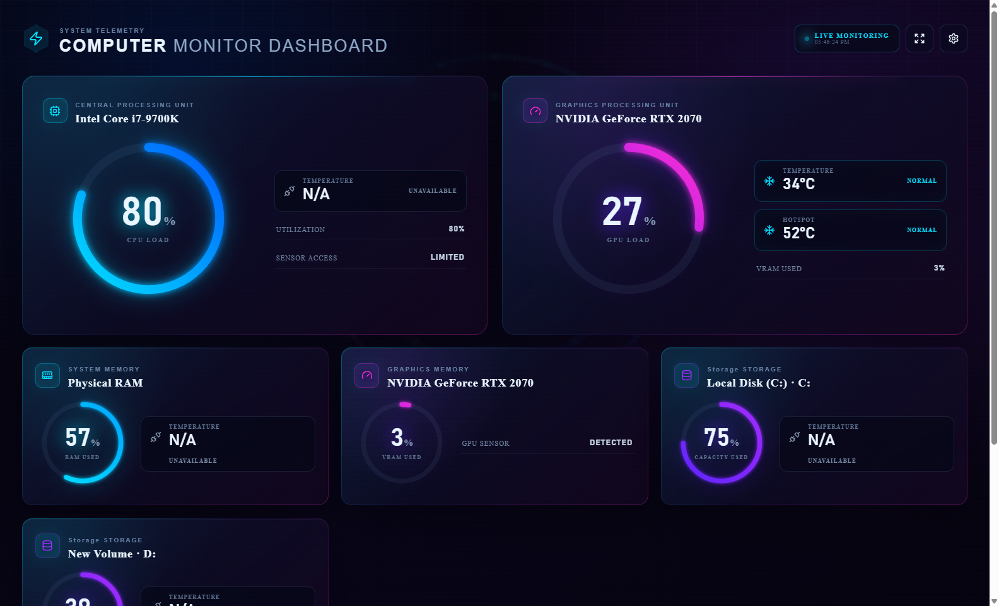

# Computer Monitor Dashboard

A private-by-design Windows 11 hardware monitor with a neon blue, purple, pink,
and cyan gaming interface. It detects the computer it is running on and shows
real sensor readings—never generated or estimated values.



## Features

- Real-time CPU utilization, model, temperature, and optional per-core view
- NVIDIA, AMD, and Intel GPU support where exposed by the installed driver
- GPU utilization, temperature, hotspot, and VRAM utilization when available
- Physical RAM utilization and module temperature when a sensor exists
- Occupied capacity and available drive temperatures for fixed storage
- Separate normal, warm, hot, and unavailable thermal states
- Configurable refresh interval, thresholds, RGB intensity, and reduced motion
- Fullscreen command-center mode
- Optional system tray controls and minimize-to-tray behavior
- Optional launch with Windows, disabled by default
- Local-only monitoring with no accounts, analytics, advertisements, or cloud

Unsupported sensor values are displayed as `N/A`. Storage percentages represent
occupied capacity, not disk activity or transfer speed.

## Download and install

1. Open the repository’s **Releases** page.
2. Download `Computer-Monitor-Dashboard-Setup.exe`.
3. Run the installer and choose an installation directory.
4. Launch **Computer Monitor Dashboard** from the Start menu or desktop.

The installer creates Start menu and desktop shortcuts. The installed
application uses a stable Windows identity and can be pinned normally to the
taskbar.

End users do not need Cursor, Node.js, Python, .NET, or any development tools.
The installer includes the Electron desktop runtime and a self-contained .NET
hardware-monitoring service. The service starts and stops with the application.

The community build is unsigned. Windows SmartScreen may therefore show an
“unrecognized app” warning until future releases are code-signed.

## System requirements

- Windows 11 x64
- A supported x64 CPU
- Current GPU and chipset/storage drivers
- Approximately 350 MB free disk space

Administrator access is not normally required. Some motherboard, NVMe, or
vendor-restricted sensors may become available only when running elevated.

## Privacy and security

- Sensor data never leaves the computer.
- The monitor binds only to a random `127.0.0.1` port.
- Every launch uses a new cryptographically random authentication token.
- The renderer has no Node.js access and runs with Electron context isolation.
- No user account, API key, cloud service, or telemetry provider is used.

## Hardware support

Hardware is detected on every launch through Windows APIs and
[LibreHardwareMonitor](https://github.com/LibreHardwareMonitor/LibreHardwareMonitor).
Available readings depend on the specific device, firmware, driver, and
permissions. A missing reading is explicitly reported as unavailable.

The application intentionally excludes clock rates, fan speed, voltage, power,
network throughput, storage transfer speed, and FPS.

## Troubleshooting

- **A temperature shows N/A:** the device or driver does not expose that sensor.
  This is different from a normal/cool reading.
- **The dashboard remains on Starting:** allow `ComputerMonitor.Service.exe`
  through endpoint-security software and restart the app.
- **GPU readings are unavailable:** install the current vendor GPU driver.
- **Additional storage sensors are needed:** try one elevated launch. Return to
  normal-user mode if no additional readings appear.
- **SmartScreen warns about the installer:** verify that the file came from this
  repository’s Releases page. Public releases should be code-signed when a
  certificate is available.

## Development

Development requires Node.js 22, npm, and the .NET 8 SDK:

```powershell
npm run install:all
npm test
npm run dev
```

Create a local self-contained release:

```powershell
npm run verify:version
npm run build
```

The installer is written to
`artifacts\release\Computer-Monitor-Dashboard-Setup.exe`.

## Publishing releases

Version values in the root package, desktop package, and monitor project must
match. After tests pass, push a semantic version tag such as `v1.0.0`. The
release workflow rebuilds and retests the project before creating a GitHub
Release and attaching the installer. See [Releasing](docs/RELEASING.md).

Automatic installation is intentionally not implemented. Optional, user-driven
GitHub Release notifications can be added later as described in
[Updates](docs/UPDATES.md).

## License

Computer Monitor Dashboard is available under the [MIT License](LICENSE).
Third-party components retain their own licenses; see
[Third-party notices](THIRD_PARTY_NOTICES.md).

This project is independent and is not affiliated with or endorsed by any
computer hardware manufacturer.
