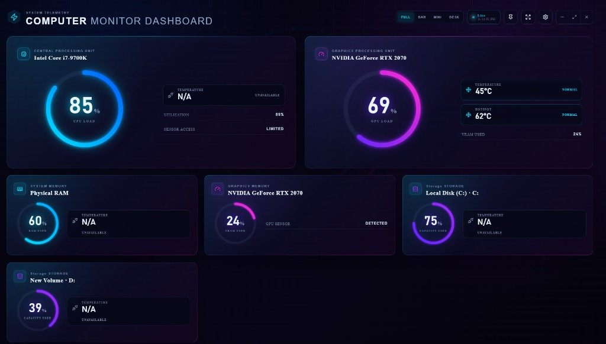

# Computer Monitor Dashboard

**Windows hardware monitor** for real-time **CPU**, **GPU**, **RAM**, **VRAM**,
and **storage** usage, with temperatures when the PC actually exposes them.

This is a local RGB system monitor and **gaming overlay** for Windows. Missing
sensors show **N/A**. Values are not invented or estimated.



**[Download for Windows (installer)](https://github.com/mk-softwars/Computer-Monitor-Dashbaord/releases/latest)**  
File: `Computer-Monitor-Dashboard-Setup.exe` · Windows x64 · no development tools required

## Download the Windows installer

Get the latest setup from GitHub Releases:

**[Download Computer-Monitor-Dashboard-Setup.exe](https://github.com/mk-softwars/Computer-Monitor-Dashbaord/releases/latest)**

You do **not** need Cursor, Node.js, or the .NET SDK. The installer includes
the desktop app and a self-contained hardware-monitoring service.

### Install

1. Open the [latest GitHub Release](https://github.com/mk-softwars/Computer-Monitor-Dashbaord/releases/latest).
2. Download **Computer-Monitor-Dashboard-Setup.exe**.
3. Run the installer.
4. Choose an installation folder when asked. The setup is a standard NSIS
   installer (not one-click).
5. Launch **Computer Monitor Dashboard** from the desktop shortcut or the
   Windows Start menu. Both shortcuts are created by the installer.
6. Wait until the top bar shows **LIVE MONITORING**. The app starts a local
   sensor service and then reads this computer.
7. Pick a display mode: **Windowed**, **Full**, **Bar**, **Mini**, or
   **Desktop**.

### Windows security prompts

v1.0.0 is **unsigned**. Windows SmartScreen or another filter may say the app
is unrecognized.

- Confirm you downloaded it from this repository’s Releases page.
- If SmartScreen appears, you can open **More info** and choose **Run anyway**
  only if you trust that source.
- **Do not** turn off Windows Security, antivirus, or SmartScreen to install
  the app.

Administrator rights are **not** required for a normal install. Some extra
drive temperatures may appear only if you later run the app elevated.

### Checksums

This release does **not** currently attach SHA-256 checksum files. When a
future release publishes a hash, you can compare it in PowerShell:

```powershell
Get-FileHash .\Computer-Monitor-Dashboard-Setup.exe -Algorithm SHA256
```

Until an official hash is published, treat the GitHub Releases page as the
source of the file, not a checksum from an unofficial site.

## Features

What the current Windows app actually does:

- Real-time hardware monitoring on a local loopback service (default refresh
  1 second; 0.5, 2, or 5 seconds in Settings)
- CPU utilization and CPU temperature when a package or core-max sensor exists
- Optional per-core utilization on the full dashboard when those sensors exist
- GPU utilization, temperature, hotspot (when present), and VRAM use for the
  first detected GPU
- NVIDIA, AMD, and Intel GPU **types** are queried when LibreHardwareMonitor
  reports them. This project’s development PC validated an **NVIDIA** path.
- RAM utilization from Windows; RAM temperature only if a memory sensor exists
- Fixed-drive occupied capacity and drive temperature when the device exposes
  one
- Thermal labels: Normal, Warm, Hot, or Unavailable (thresholds are editable)
- Fullscreen (the expand control) and a resizable **Windowed** dashboard
- Maximized **Full** dashboard
- Floating **Bar** and **Mini** overlays (about 750×85 pixels)
- **Desktop Background** mode (dashboard over the work area; not wallpaper)
- **Always on Top** for Bar and Mini
- Overlay opacity 10–100% (default 90%) on Bar and Mini only
- **Click-Through** on Bar and Mini, with tray and keyboard recovery
- System tray, optional minimize-to-tray, optional start with Windows
- RGB neon blue, purple, pink, and cyan visual design inspired by gaming
  hardware lighting (including Alienware-style RGB). See
  [No affiliation](DISCLAIMER.md#h-no-affiliation).

The app does **not** show clock speeds, fan RPM, voltages, power draw, network
speed, disk transfer rate, or FPS.

## Known limitations

- **Unsupported sensors.** If a value is **N/A**, this PC did not provide that
  reading. Many CPU, RAM, and drive temperatures are missing on ordinary
  laptops and desktops.
- **Fullscreen games.** Exclusive fullscreen can cover the overlay. Use
  borderless windowed if you want the bar visible. The app does not inject
  into games.
- **Desktop Background.** This is not a wallpaper and does not sit under
  desktop icons. Clicks pass through; other windows cover the dashboard.
  Restore from the tray.
- **One GPU card on the dashboard.** Extra GPUs may be detected internally;
  the main UI shows the first GPU.
- **Motherboard sensors** are not enabled in this build.

## How to use

### Read utilization

On the full dashboard, large gauges are **load** or **capacity used** as a
percentage:

| Reading | Meaning |
| --- | --- |
| CPU LOAD | How busy the processor is right now |
| GPU LOAD | How busy the graphics processor is right now |
| RAM USED | Share of physical memory in use |
| VRAM USED | Share of graphics memory in use |
| CAPACITY USED | How full a fixed drive is, not how fast it is copying files |

Bar and Mini show the same kinds of numbers in a compact row.

### Read temperatures

Temperatures appear in **°C** with a status of Normal, Warm, Hot, or
Unavailable. You can change Warm/Hot thresholds in Settings → Temperature.

**N/A** means “no sensor,” not “zero degrees” and not “safe.”

### Switch display modes

On the full dashboard, use the **Windowed / Full / Bar / Mini / Desktop**
controls in the top bar. In a narrow window those choices appear in a
dropdown.

You can also right-click the tray icon and choose a mode.

| Mode | What you get |
| --- | --- |
| Windowed | Resizable RGB dashboard |
| Full | Maximized dashboard |
| Bar | Horizontal overlay |
| Mini | Same overlay family as Bar |
| Desktop | Full dashboard behind other windows, no taskbar button |

More detail: [Display modes](docs/DISPLAY_MODES.md).

### Resize and move

- **Windowed dashboard:** drag edges to resize. Drag the top header to move.
  Double-click the header to maximize or restore.
- **Bar / Mini:** drag the bar to move it, unless **Lock Position** is on.
  Compact/normal size presets live in Settings → Display.

### Pin, opacity, and Click-Through

On Bar or Mini:

1. **Pin** (pin icon) turns **Always on Top** on or off.
2. Open the gear, then set **Overlay Opacity**.
3. Enable **Click-Through** so clicks go to the game or app underneath.

Click-Through makes the overlay itself unclickable. Turn it off from:

- Tray → **Disable Click-Through**
- **Ctrl+Shift+F10** (or the shortcut you selected in Settings)

Settings for Click-Through apply to Bar and Mini after the settings panel
closes.

### Desktop Background

Choose **Desktop** in the mode switch. This does not change your wallpaper.
Open **Open Full Dashboard** from the tray when you want the normal window
back.

### Exit completely

- If **Minimize to tray** is off, the window **Close** (X) exits.
- If **Minimize to tray** is on, Close hides the window. Use the tray item
  **Exit Application** to quit.

## System requirements

Verified packaging target:

| Item | What this project states |
| --- | --- |
| OS | Windows x64 installer. Development and packaging were done on **Windows 11 x64**. Other Windows versions are not claimed as tested here. |
| CPU | 64-bit (x64) |
| Installer | About **154 MB** (`Computer-Monitor-Dashboard-Setup.exe`) |
| Disk | Plan several hundred MB for the installed Electron runtime, .NET runtime, and monitor service (the unpacked app payload is larger than the setup file) |
| Admin | Not required to install or to run for basic CPU/RAM/GPU load |
| GPU | Readings appear when LibreHardwareMonitor and the vendor driver expose them. NVIDIA was used on the development PC. |
| Network | Not required for monitoring |

Included with the installer (you do not install these yourself):

- Electron desktop runtime
- Self-contained .NET 8 monitor service
- LibreHardwareMonitor library
- License and third-party notice files

## Troubleshooting

See **[TROUBLESHOOTING.md](TROUBLESHOOTING.md)** for:

- N/A temperatures
- Overlay hidden by games
- Click-Through recovery
- Off-screen windows
- SmartScreen
- Uninstall

## Privacy

Hardware readings stay on this computer. See **[PRIVACY.md](PRIVACY.md)**.

## Disclaimer

The software is provided **AS IS**. It is not a safety system and is not
affiliated with Dell or Alienware. Read **[DISCLAIMER.md](DISCLAIMER.md)**
before relying on any reading.

## Report bugs and suggest features

Please use **GitHub Issues** on this repository. That is the right place for
crash reports, missing sensors on a specific PC, overlay problems, and
feature ideas.

**[Open an issue](https://github.com/mk-softwars/Computer-Monitor-Dashbaord/issues)**

Include Windows version, display mode (Windowed, Full, Bar, Mini, or
Desktop), and whether the status bar showed LIVE MONITORING. Do not attach
hardware serial numbers or unrelated system logs.

## License

Computer Monitor Dashboard is licensed under the [MIT License](LICENSE).

Third-party components keep their own licenses. See
[THIRD_PARTY_NOTICES.md](THIRD_PARTY_NOTICES.md).

## Development

For contributors. End users should use the installer above.

Requires Node.js 22, npm, and the .NET 8 SDK:

```powershell
npm run install:all
npm test
npm run dev
```

Local installer build:

```powershell
npm run verify:version
npm run build
```

Output: `artifacts\release\Computer-Monitor-Dashboard-Setup.exe`.
